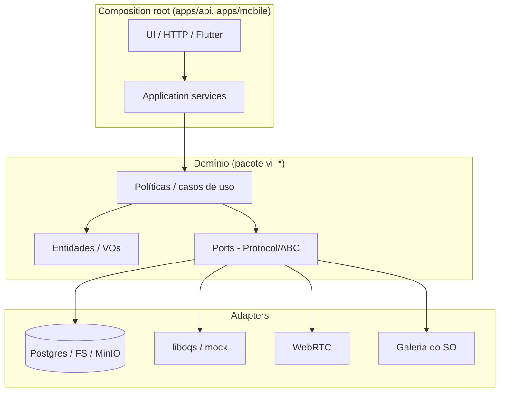
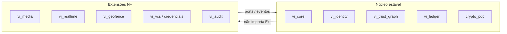

# Implementação hexagonal no Ví

## Conceito em uma frase

Cada capacidade do Ví é um **módulo de domínio** com **ports** (contratos) e **adapters** (infra). O app (API/mobile) só **compõe** esses módulos. A conversa em si é **ponto a ponto**; a coordenação central não carrega plaintext.

## Camadas por módulo

Regra: **dependências apontam para dentro** (domínio não importa adapters).

## Como um módulo novo entra (receita)

Exemplo: adicionar `vi_geofence` (7º, 8º, … módulo):

1. Criar `packages/vi_geofence/` com modelos + `GeofencePort`.
2. Implementar `InMemoryGeofence` (testes) e depois `PostgresGeofenceAdapter`.
3. Registrar feature flag em `config/modules.yaml`.
4. Wire no composition root (`vi_api/container.py` / mobile DI).
5. Application service chama o port **sem** conhecer SQL/GPS vendor.
6. Testes de domínio com mock do port.

Não é necessário alterar `vi_ledger` ou `vi_trust_graph` além de eventos/contratos explícitos.

## Mapa de módulos atuais → implementação

| Pacote | Port principal | Adapter fase 0 | Adapter alvo |
|--------|----------------|----------------|--------------|
| `vi_trust_graph` | `TrustGraphPort` | In-memory | Postgres + policy engine |
| `vi_ledger` | `ConversationLedgerPort` | In-memory hash-chain | FS/SQL append-only + blob |
| `vi_media` | `MediaExportPort` | Prefixo watermark stub | Pipeline WM + EXIF/XMP |
| `vi_crypto_pqc` | `PqcCryptoPort` | `MockPqcProvider` | liboqs / oqs-provider |
| `vi_identity` | registro de nós/devices | In-memory | Secure storage + attestation |
| `vi_realtime` | `RealtimeSessionPort` | Stub + flag | WebRTC P2P |
| *(futuro)* `vi_conversation_keys` | chaves `K_{U,C}` + HW | — | Enclave / Keystore |

## Escala além de 6 módulos

**Critério de pronto de um módulo:** testes de política sem UI; adapters substituíveis; flag off = zero efeito colateral.

## Anti-padrões a evitar

- Domínio importando FastAPI, SQLAlchemy ou Flutter.
- “God service” na API que implementa regras de grafo + ledger + mídia.
- Rotação de chave em uma conversa sem evento global de hardware ([06](06-chaves-hardware-e-ui.md)).
- Servidor como store de plaintext de mensagens (quebra o modelo P2P).
