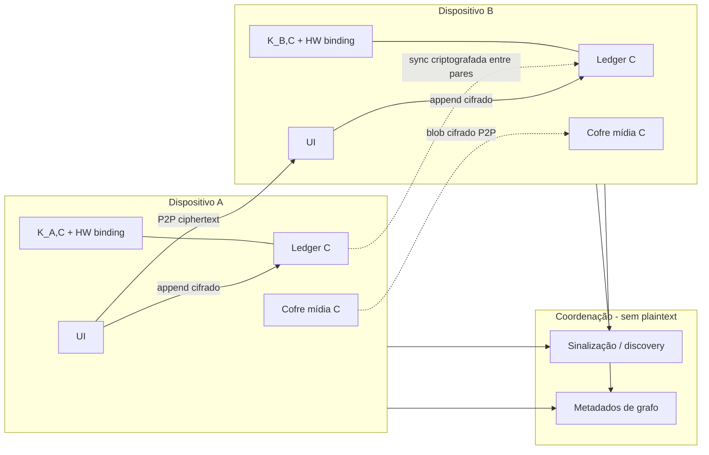
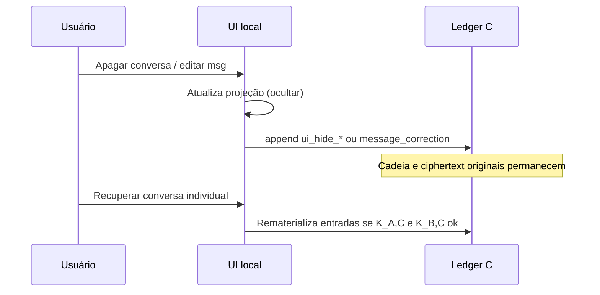

# Fluxo de dados — Ví

## Princípio

Dados de **conteúdo** (mensagens, mídia, áudio/vídeo) circulam e persistem sob controle dos **pares** (P2P + ledger local/replicado entre participantes). O servidor de coordenação, se existir, trata **metadados mínimos** (grafo, sinalização, presença), nunca plaintext da conversa.

## Visão geral

## Categorias de dados

| Categoria | Onde vive | Quem lê |
|-----------|-----------|---------|
| Entradas do ledger (ciphertext) | Dispositivos dos participantes (+ réplica opcional cifrada) | Só com `K_{U,C}` dos envolvidos |
| Projeção UI (ocultar/editar) | Preferências locais do usuário | Só o dono da UI |
| Grafo (arestas, âncoras) | Coordenação + cache local | Política de minimização |
| Chaves `K_{U,C}` | Secure element / keystore do hardware | Só o usuário U no device atual |
| Mídia exportada | Fora do cofre, com WM + metadados | Quem recebe o arquivo |

## Soft-delete / edição (só UI)

## Dados que NÃO atravessam o servidor em claro

- Corpo de mensagem
- Bytes de mídia do cofre
- Áudio/vídeo da chamada
- Chaves de conversa ou épocas

Ver também: [09-fluxo-comunicacao-p2p.md](09-fluxo-comunicacao-p2p.md), [06-chaves-hardware-e-ui.md](06-chaves-hardware-e-ui.md).
