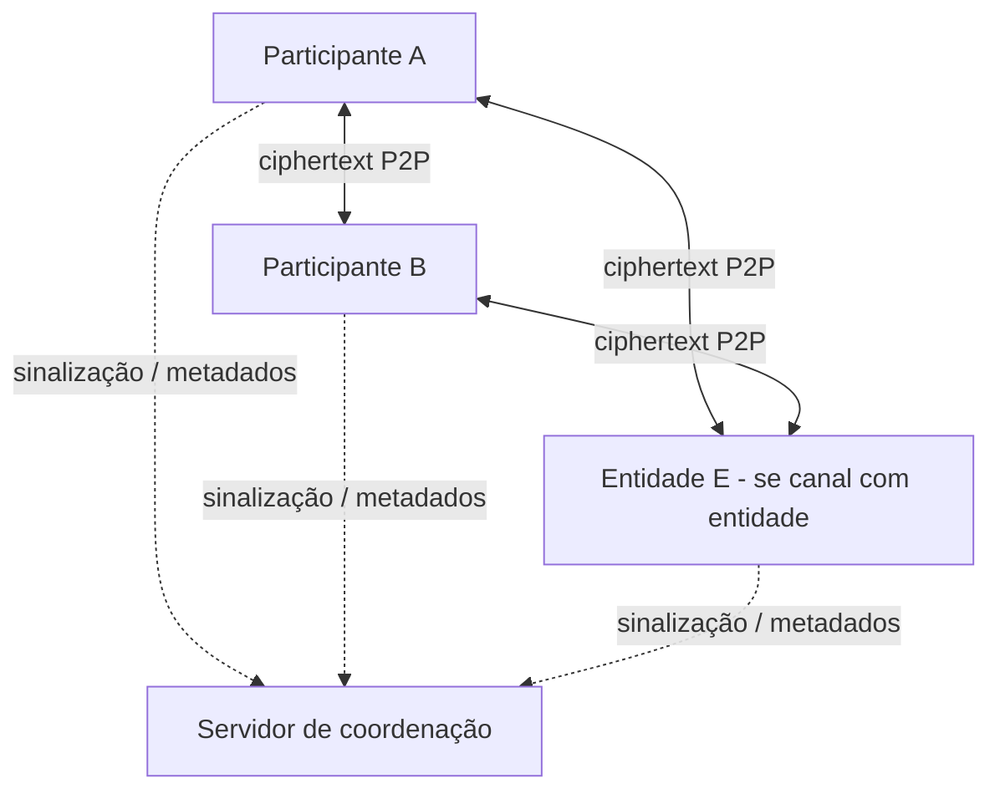
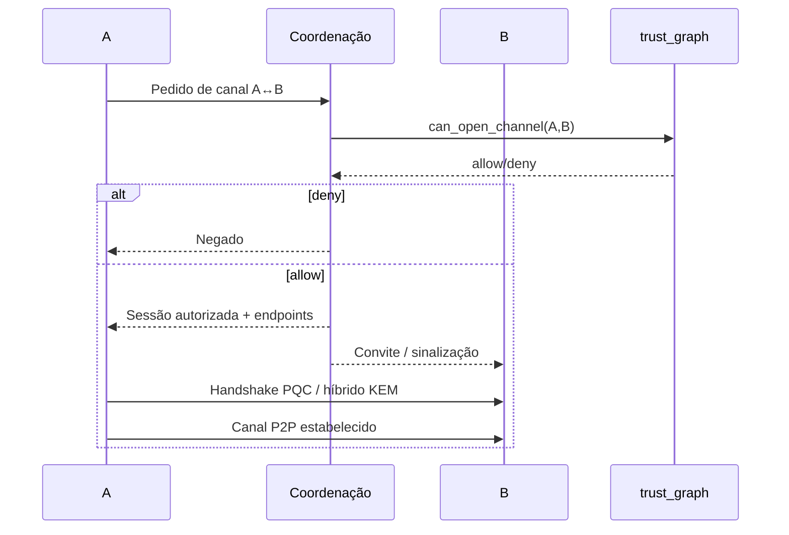

# Fluxo de comunicação — sempre ponto a ponto

## Regra

No Ví, a comunicação de conteúdo é **sempre ponto a ponto (P2P)** entre os nós autorizados do canal (indivíduo–indivíduo ou indivíduo–entidade). Não há “hub” que recebe plaintext ou que retransmite mensagens legíveis.



## O que é P2P neste modelo

| Plano | Meio | Conteúdo |
|-------|------|----------|
| **Dados** | Canal P2P (ex.: WebRTC data channel / sessão E2EE) | Mensagens, refs de mídia, eventos de ledger |
| **Mídia A/V** | WebRTC P2P (SRTP/E2EE) | Voz e vídeo |
| **Controle** | Sinalização via coordenação | SDP/ICE, convites, avisos de rotação de HW — sem corpo de chat |

NAT traversal (STUN/TURN) pode relaying **bytes opacos**; o relay **não** é parte da confiança criptográfica.

## Abertura de canal (antes do P2P)



## Envio de mensagem (P2P)

```mermaid
sequenceDiagram
  participant A as A
  participant B as B

  A->>A: AEAD com época de C; assina entrada
  A->>A: append local no ledger C
  A->>B: entrega ciphertext + metadados de cadeia
  B->>B: verifica sig + prev_hash; append local
  Note over A,B: Servidor não vê plaintext
```

## Entidade no caminho social ≠ entidade no caminho de dados

Uma **entidade reconhecida** pode *autorizar* o par (grafo), mas a conversa A↔B autorizada continua **P2P entre A e B**. A entidade só entra no plano de dados se for ela própria participante do canal.

## Chamada de voz/vídeo

1. Sinalização (oferta/resposta) via coordenação.
2. Mídia: P2P WebRTC com material de chave alinhado ao handshake PQC/híbrido.
3. Gravação (se política permitir): vira entradas no ledger da conversa nos dispositivos, não em “nuvem aberta”.
