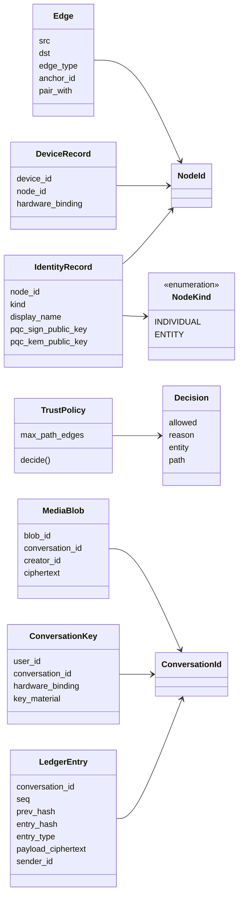
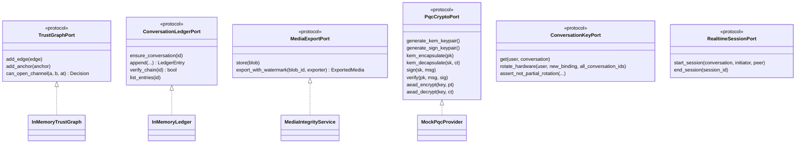
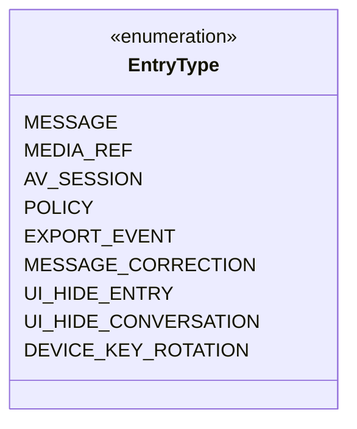
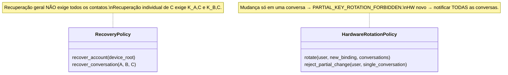

# Diagrama de classes — domínio Ví

Visão lógica (conceito). Nomes alinhados aos pacotes `vi_*`; a implementação proprietária pode variar, mantendo os contratos.

## Visão geral dos contextos

## Ports (contratos hexagonais)

## Tipos de entrada do ledger

## Regras de chave (resumo em classes)

