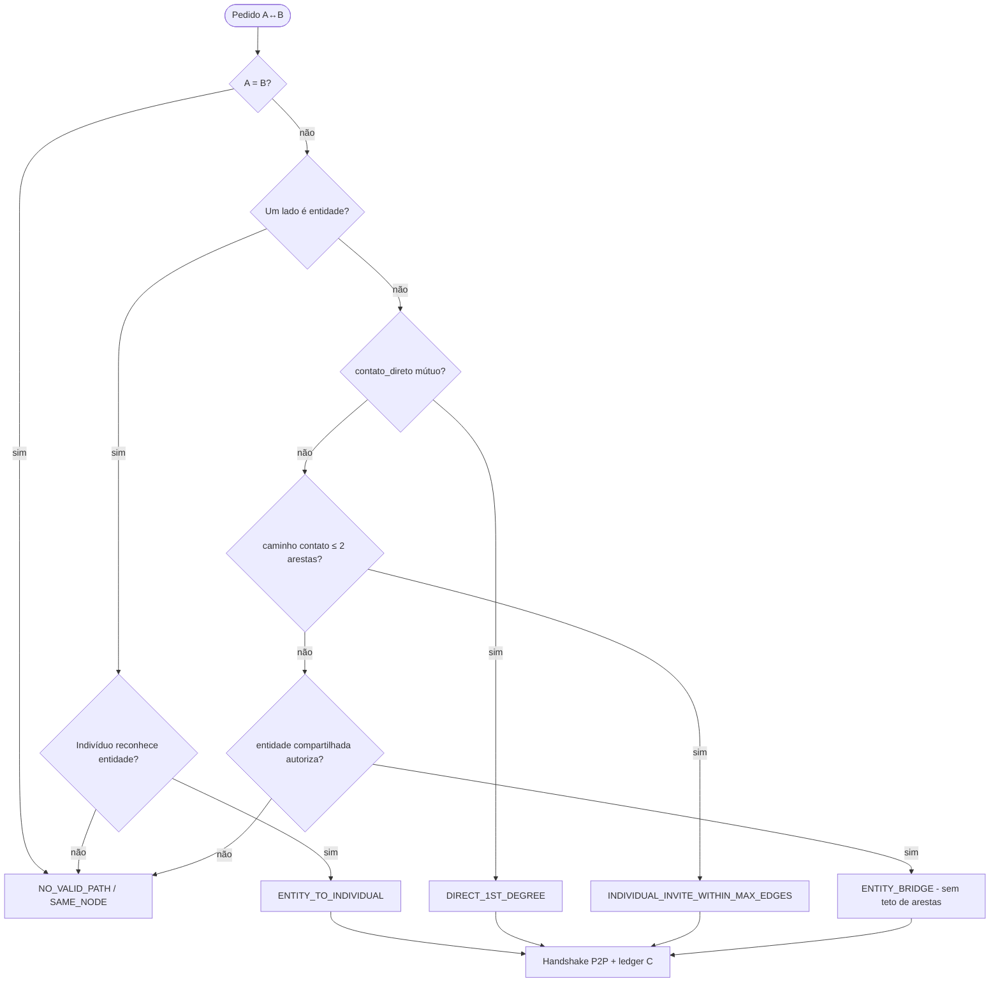
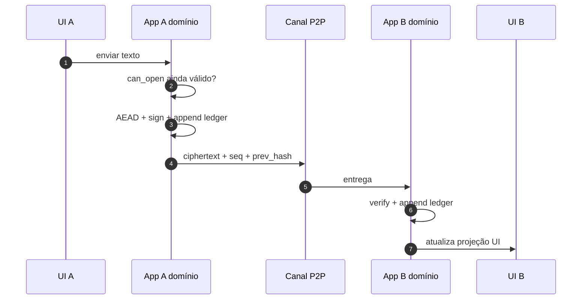
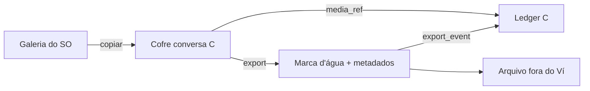
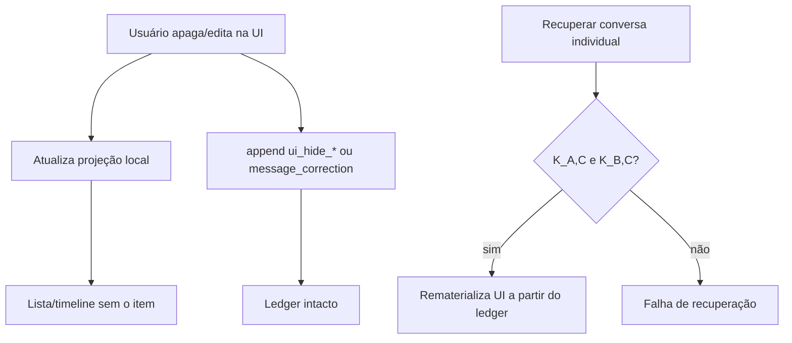
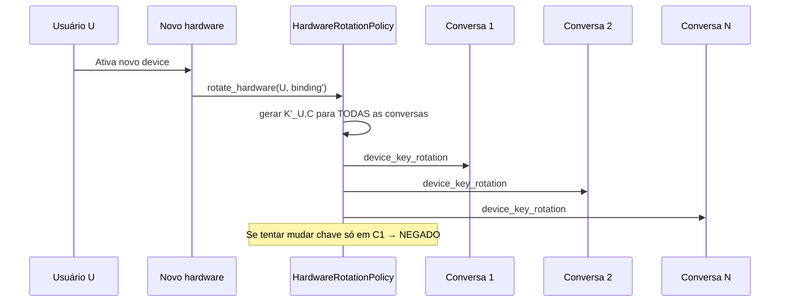
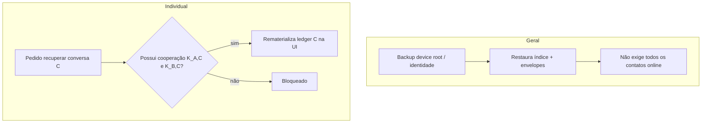

# Diagramas de fluxo — Ví

Sequências operacionais principais (conceito/lógica).

## 1. Autorizar e abrir canal

## 2. Mensagem P2P + ledger

## 3. Importar mídia da galeria e exportar com marca d’água

## 4. Soft-delete / edição (UI only)

## 5. Mudança de hardware

## 6. Recuperação

