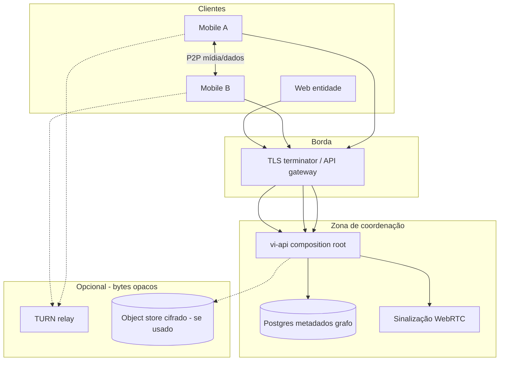
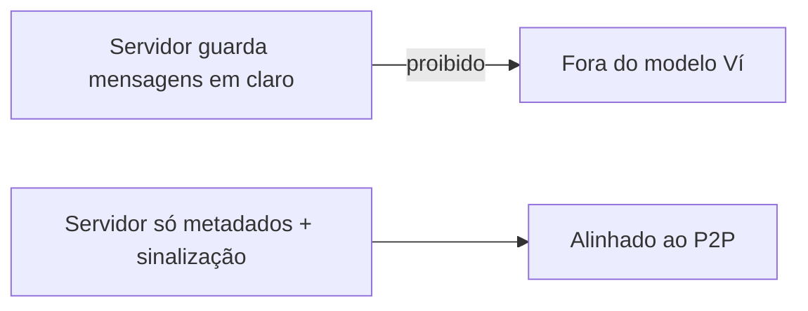
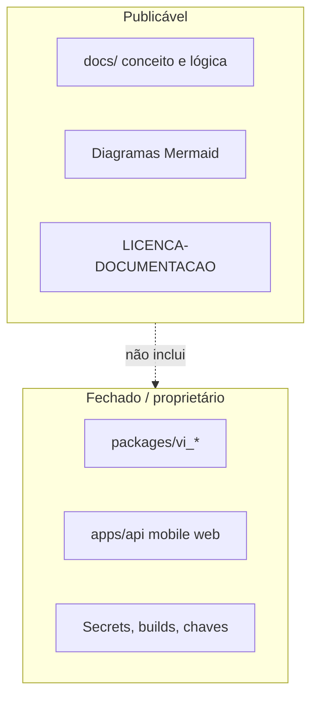
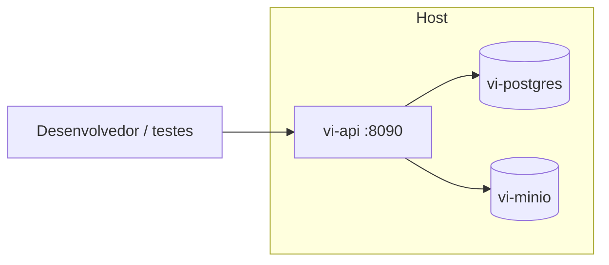

# Esquema de implantação — Ví

## Princípios

1. **Clientes** (mobile/web) detêm chaves de conversa e ledgers cifrados.
2. **Coordenação** é componente auxiliar (grafo, sinalização, discovery) — **sem plaintext**.
3. Código da aplicação Ví é **proprietário**; a documentação de conceito/lógica pode ser pública ([LICENCA-DOCUMENTACAO.md](LICENCA-DOCUMENTACAO.md)).
4. Bibliotecas cripto de terceiros (ex.: liboqs) entram como dependências com licenças próprias.

## Topologia alvo

## Ambientes

| Ambiente | Papel |
|----------|-------|
| Dev local | `docker compose --profile vi` (API + Postgres + MinIO); crypto `mock` |
| Staging | Coordenação + clientes de teste; PQC híbrido |
| Produção | Clientes com keystore/HW binding; coordenação HA; sem logs de plaintext |

## O que NÃO implantar como “chat server” clássico

## Separação código × documentação

## Diagrama de containers (esqueleto)

Perfil Compose: `vi` (ver `vi/docker-compose.yml`). Em produção o object store só recebe **blobs já cifrados** pelos clientes, se for usado.
